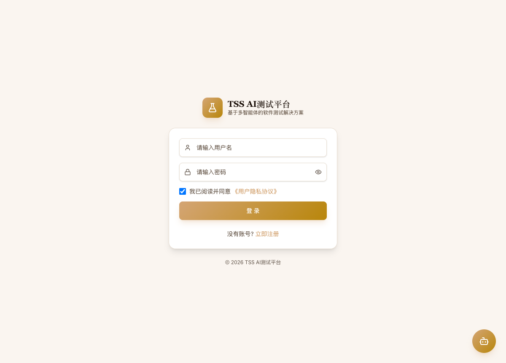
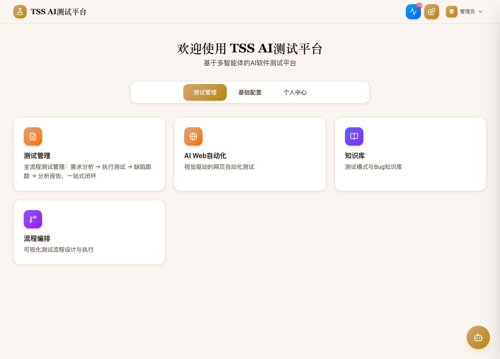
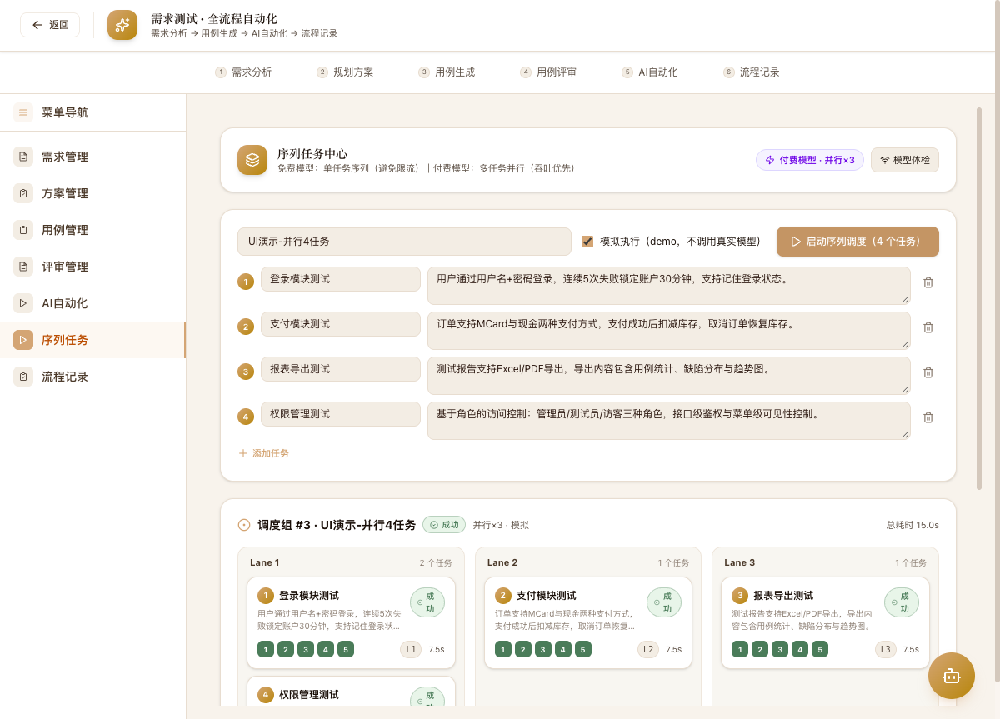
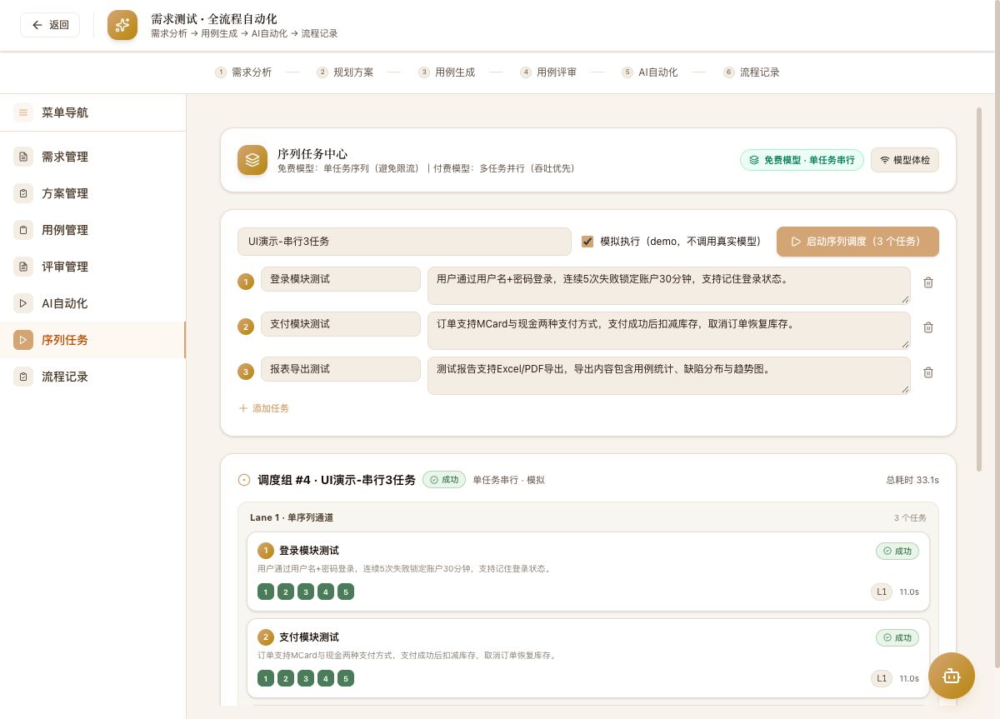
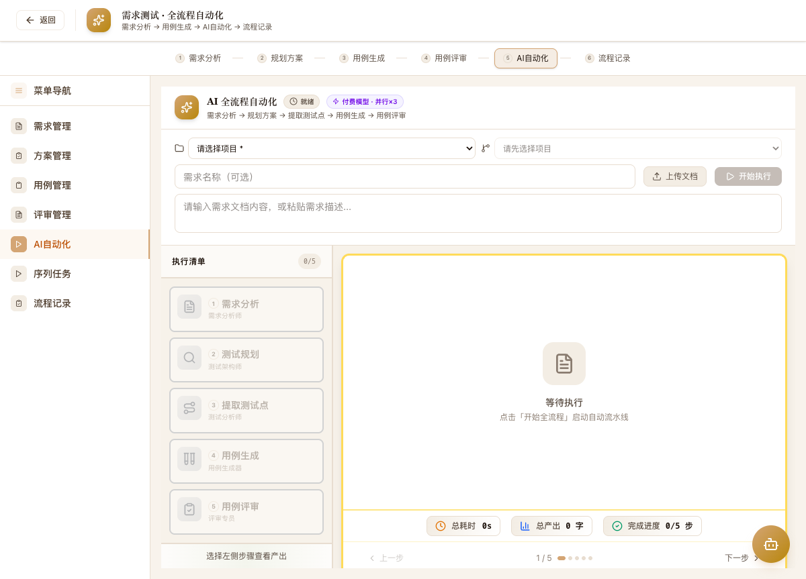
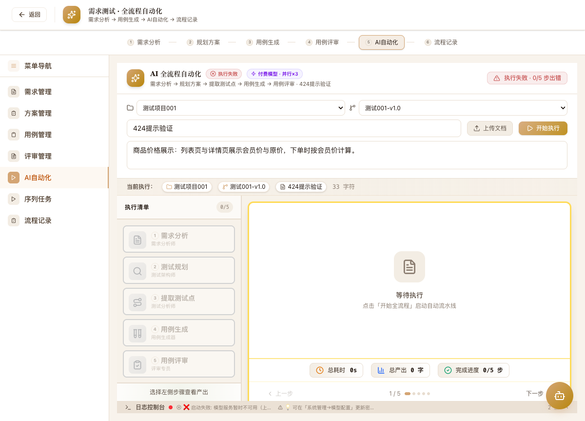
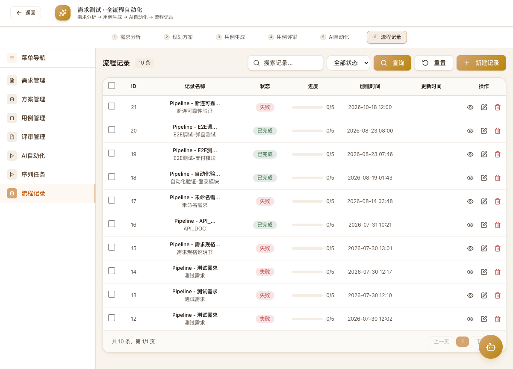

# TSS AI测试平台

> 基于AI驱动的智能软件测试平台，集成需求分析、用例生成、自动化执行、缺陷管理全流程

## 项目简介

TSS（Test System Service）是一个AI驱动的软件测试平台，覆盖软件测试全生命周期。平台通过AI Agent自动探索网页、生成测试用例、执行测试并分析缺陷，大幅提升测试效率。

### 核心特性

- **AI全流程Pipeline** — 从需求文档到测试报告的端到端自动化
- **序列任务中心** — 免费模型自动单任务串行、付费模型多任务并行调度；断点续传、逐阶段落库、断线不丢进度
- **AI Web自动化** — 多引擎支持：Midscene.js / Playwright MCP / Browser Use / UI-TARS
- **AI智能体面板** — 自然语言描述测试意图，AI自动规划并执行全流程
- **测试技能库** — 选择器/断言/场景模板，可复用的测试技能资产
- **智能Agent工作流** — 可视化DAG画布编排多Agent协作流程
- **知识库RAG搜索** — 测试模式库 + Bug知识库 + AI语义搜索
- **实时协作** — WebSocket/SSE实时推送测试进度

## 技术栈

### 前端

| 技术 | 版本 | 用途 |
|------|------|------|
| React | 19.x | UI框架 |
| Vite | 8.x | 构建工具（代码分割 + 懒加载） |
| TypeScript | 6.x | 类型安全 |
| Tailwind CSS | 4.x | 样式系统 |
| Zustand | 5.x | 状态管理 |
| React Router | 7.x | 路由 |
| TanStack Query | 5.x | 数据请求缓存 |
| Recharts | 3.x | 图表可视化 |
| Framer Motion | 12.x | 动画 |
| Lucide React | 1.x | 图标库 |

### 后端

| 技术 | 版本 | 用途 |
|------|------|------|
| FastAPI | 0.115.x | Web框架 |
| SQLAlchemy | 2.0.x | ORM（异步） |
| SQLite | - | 数据库（开发环境） |
| Pydantic | 2.x | 数据验证 |
| Loguru | 0.7.x | 日志系统 |

### AI/自动化

| 技术 | 用途 |
|------|------|
| midscene.js | 视觉驱动的网页自动化 |
| Playwright MCP | 基于MCP协议的浏览器自动化 |
| Browser Use | Python AI Agent驱动浏览器（预留） |
| UI-TARS | 字节跳动多模态GUI Agent（预留） |
| 阿里云DashScope | qwen-vl-max 视觉模型 |
| OpenAI API | LLM对话（DeepSeek） |

## 项目结构

```
tts-paper-test/
├── frontend/                 # 前端 React 19 应用
│   ├── src/
│   │   ├── components/       # 共享组件（ai-assistant / crud / layout / markdown / ui / shared）
│   │   ├── hooks/            # 自定义Hooks（useModuleData等）
│   │   ├── lib/              # API客户端、工具函数
│   │   ├── pages/            # 页面组件（18个模块目录）
│   │   └── stores/           # Zustand状态管理
│   ├── App.tsx               # 路由入口（40+ 懒加载页面）
│   └── package.json
├── backend/                  # 后端 FastAPI 应用
│   ├── api/                  # API路由（19个模块）
│   ├── agents/               # AI Agent（探索/生成/执行/生命周期）
│   ├── engines/              # 测试引擎抽象层（5种引擎 + 注册表）
│   ├── models/               # SQLAlchemy数据模型（15个模块 ~55 模型）
│   ├── schemas/              # Pydantic Schema
│   ├── services/             # 业务逻辑层（pipeline / workflow / knowledge / config 等）
│   ├── core/                 # 安全、日志、异常处理
│   ├── scripts/              # E2E测试脚本
│   └── main.py               # 应用入口
├── docs/                     # 项目文档（PRD / 架构 / 模块 / 设计规格 / 操作手册 / 截图）
├── demo/                     # GitHub Pages 静态数据记录 Demo（build_data.py 脱敏导出）
├── e2e/                      # Playwright 端到端测试
├── scripts/                  # 数据库初始化等脚本
└── playwright.config.ts      # E2E 测试配置
```

## 功能模块

### 核心模块

| 模块 | 功能 | 路由 |
|------|------|------|
| 登录注册 + 仪表盘 | 用户认证、统计概览、快捷入口、活动动态 | `/`, `/login`, `/activities` |
| 测试管理中心 | 左侧栏布局：需求→计划→测试点→用例→评审→执行→缺陷→报告全流程，含 AI全流程(3Tab) / 平台对标分析 / 版本管理 / 用户与角色 / 项目与步骤提示词 | `/test-management/*` |
| 需求测试 | 全流程：需求→方案→测试点→用例→评审，含 AI Pipeline | `/requirement-testing` |
| AI用例生成 | 按类型(单接口/流程/UI/性能等) 5步流水线自动生成测试用例 | `/ai-automation` |
| AI Web自动化 | 项目管理+AI智能体+AI探索+对象库+用例生成+测试执行 | `/ai-web-automation` |
| AI接口自动化 | 基于 OpenAPI 的接口用例自动生成与执行 | `/api-test` |
| AI App自动化 | App 自动化测试 | `/app-test` |
| AI通用测试任务 | 通用 AI 测试任务调度 | `/ai-test-tasks` |
| 数据工厂 | 测试数据构造与工厂管理 | `/data-factory` |
| 执行管理 | 执行列表、详情、调度配置 | `/executions`, `/execution-schedules` |
| 缺陷管理 | 列表+看板+AI根因分析+趋势图表 | `/defects`, `/kanban`, `/root-cause`, `/trend` |
| 分析报告 | AI生成报告、质量概览、趋势图表 | `/reports`, `/ai-report`, `/quality` |
| 用户管理 | 列表+状态+角色权限+登录日志+设备管理 | `/users`, `/roles` |
| 基础配置 | 环境+LLM+提示词+风格+MCP+Skills+步骤提示词等 10 类配置 | `/api/v1/config` |
| 知识库 | 测试模式库+Bug知识库+RAG+AI语义搜索 | `/knowledge-base` |
| 流程编排 | SVG DAG画布+多节点+执行引擎+执行历史 | `/workflow-orchestration` |
| MCP市场 | MCP 服务市场管理与安装 | `/mcp-marketplace` |
| 平台对标分析 | 与竞品测试平台的 AI 能力对标 | `/test-management/comparison` |

### AI Agent架构

```
自然语言输入 → AI智能体面板 → 自动规划 → 多步骤执行
                              ↓
     ┌─────────────────────────────────────────────┐
     │           5种测试引擎可选                      │
     │  Midscene.js │ Playwright MCP │ Mock         │
     │  Browser Use │ UI-TARS                       │
     └─────────────────────────────────────────────┘
                              ↓
  URL探索 → 页面分析 → 用例生成 → 用例评审 → 测试执行 → 报告
```

## 🎬 全流程演示（真实截图）

> 平台已上线功能的完整操作路径演示。详细文字版见 [`docs/OPERATION_MANUAL.md`](docs/OPERATION_MANUAL.md)。

### ① 登录 → 工作台

账号 `admin / admin123` 登录后进入工作台，四大能力域一目了然。

| 登录 | 工作台 |
|---|---|
|  |  |

### ② 序列任务中心（免费串行 / 付费并行 自动调度）

`需求测试 → 序列任务`：一次性提交多个需求任务，系统按当前模型档位自动选择执行模式——

- **免费模型**：单任务串行（并发=1），保护免费额度不被限流；
- **付费模型**：并行 N 条序列泳道（默认 3），泳道完成即刻领取下一个任务。

右上角模式徽章实时反映档位；「模拟执行」可在无模型环境下演示完整调度流程。

| 并行×3 执行中（泳道看板） | 并行完成（Lane1 复用 2 任务，15s = 2 批） |
|---|---|
|  |  |

| 免费档：单泳道串行排队 | 历史调度组（模式/成败/耗时全留痕） |
|---|---|
|  |  |

### ③ AI 全流程自动化（五阶段序列 + 可靠性）

`需求测试 → AI自动化`：执行清单按 ①需求分析→②规划→③测试点→④用例→⑤评审 顺序推进，序号即依赖，当前阶段未完成后续锁定。

- 每阶段完成即 **checkpoint 落库**，页面刷新/断网**执行不中断**，可实时重连接续传；
- 空输出/截断输出判失败，**杜绝静默假成功**；
- 上游模型故障/密钥过期 → 启动即返回 **424 明确原因与修复指引**。

| 就绪态（模式徽章） | 424 友好降级提示 |
|---|---|
|  |  |

### ④ 流程记录（结果可追溯）

每次执行自动建档：五阶段进度、耗时、状态、所属序列泳道；执行中记录一键「实时进度」续传，失败记录支持「继续执行」断点恢复。



### ⑤ 在线数据记录 Demo（GitHub Pages 纯静态托管）

仓库内置 [`demo/`](demo/) 目录 —— 不依赖任何服务器的**纯 GitHub 托管**执行数据回放页：真实流水线记录、序列调度组泳道回放、模型档位与平台截图，数据由 `demo/build_data.py` 从数据库**脱敏导出**（自动移除密钥/需求正文）。

**开启方式（仓库 Settings → Pages）：**

1. `Settings → Pages → Build and deployment → Source: Deploy from a branch`
2. `Branch: main` + `Folder: /tts-paper-test/demo` → Save
3. 访问 `https://<用户名>.github.io/TSS-System/` 即可在线查看执行数据 Demo

本地预览（可选）：`python3 -m http.server 8899 --directory demo` → `http://127.0.0.1:8899`
数据刷新（可选）：`python3 demo/build_data.py`（重新导出并拷贝截图）

## 快速开始

### 环境要求

- Node.js 18+
- Python 3.12+
- Chromium（Playwright自动安装）

### 启动后端

```bash
cd backend
python -m venv .venv
source .venv/bin/activate
pip install -r requirements.txt
python -m uvicorn main:app --reload --port 8000
```

API文档: http://localhost:8000/docs

### 启动前端

```bash
cd frontend
npm install
npm run dev
```

访问: http://localhost:5173

> 端口被占用时可指定：`VITE_PORT=5174 VITE_PROXY_TARGET=http://localhost:8010 npm run dev -- --port 5174`（代理指向后端）。

### 序列调度相关环境变量（backend/.env，均可选）

| 变量 | 默认 | 说明 |
|------|------|------|
| `MODEL_TIER` | `auto` | 强制档位：`free`(全局串行)/`paid`(并行)/`auto`(按模型配置识别) |
| `MAX_PARALLEL_SEQUENCES` | `3` | 付费模式并行泳道数（上限 8） |
| `MIN_STAGE_OUTPUT_CHARS` | `80` | 阶段最短有效输出（低于判失败，防静默假成功） |

### 测试账号

- 用户名: `admin`
- 密码: `admin123`

### 运行E2E测试

```bash
cd backend
npx playwright install chromium
node scripts/e2e-test.mjs
```

## API概览

后端共 **19 个 API 模块**，绝大多数挂载于 `/api/v1` 前缀，另含 WebSocket 与 SSE 实时通道。

| 模块 | 前缀 | 说明 |
|------|------|------|
| 认证 | `/api/v1/auth` | 登录、注册、Token 刷新 |
| 用户管理 | `/api/v1/users` | 用户 CRUD、状态、登录日志、设备 |
| 角色管理 | `/api/v1/roles` | 角色权限管理 |
| 测试生命周期 | `/api/v1/test-lifecycle` | 需求/计划/测试点/用例/执行/缺陷/评审/报告/调度 |
| AI Web自动化 | `/api/v1/web-automation` | 项目、页面、对象库、用例、执行、WebSocket |
| AI接口自动化 | `/api/v1/api-test` | OpenAPI 驱动的接口用例生成与执行 |
| AI App自动化 | `/api/v1/app-test` | App 自动化测试 |
| AI通用测试任务 | `/api/v1/ai-test-tasks` | 通用 AI 测试任务 |
| 数据工厂 | `/api/v1/data-factory` | 测试数据构造 |
| 项目管理 | `/api/v1/projects` | 项目、版本管理 |
| 全流程Pipeline | `/api/v1/pipeline` | 需求→用例→执行→报告端到端流水线（含断点续传 stream） |
| 序列调度 | `/api/v1/sequence` | 多任务序列调度：模式识别/启动/泳道Stream/取消 |
| 需求数据 | `/api/v1/data` | 需求测试各阶段数据管理 |
| 基础配置 | `/api/v1/config` | 环境/LLM/提示词/风格/MCP/Skills/步骤提示词等 |
| 知识库 | `/api/v1/knowledge` | 测试模式库、Bug库、RAG 搜索 |
| AI对话 | `/api/v1/ai` | AI 智能助手对话 |
| 引擎管理 | `/api/v1/engines` | 测试引擎注册、健康检查 |
| MCP市场 | `/api/v1/mcp-marketplace` | MCP 服务市场 |
| 工作流编排 | `/api/v1/workflows` | DAG 工作流 CRUD + 执行 |
| —（SSE） | `/events` | 服务端事件实时推送 |

## 性能优化

- **代码分割**: 40+ 页面组件 React.lazy 懒加载，按路由拆分代码，首屏加载更快
- **骨架屏**: 加载页面使用 Skeleton 组件替代旋转指示器
- **轮询优化**: 执行详情页无运行任务时自动停止轮询
- **查询缓存**: TanStack Query 缓存服务端状态，减少重复请求

## 设计系统

- **主题**: Polaroid暖白色调（--color-paper: #FAF5F0）
- **字体**: Georgia serif (标题) + Inter/system-ui (正文)
- **阴影**: 暖色阴影（rgba(139,105,20,...)）
- **圆角**: 统一xl/2xl圆角

## 测试

| 类型 | 工具 | 覆盖 |
|------|------|------|
| 单元测试 | pytest | 后端API |
| E2E测试 | Playwright | 14项端到端测试 |
| 类型检查 | TypeScript | 前端全量类型检查 |

## License

Private - 仅供内部使用
