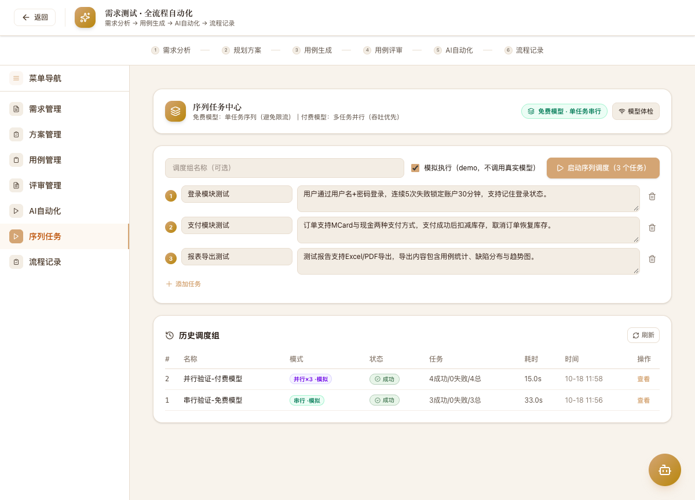

# TSS AI 测试平台 · 操作手册

> 版本：v3 ｜ 更新日期：2026-10-19 ｜ 配套代码：`tts-paper-test/`
>
> 本手册面向平台使用者，覆盖登录、需求测试全流程、**序列任务中心（本次新增）**、全流程自动化、流程记录与模型配置的完整操作路径。系统架构与实现细节见 `docs/specs/SPEC-001-序列调度与结果可靠性/`。

---

## 1. 平台概述

TSS 是基于多智能体的 AI 软件测试平台，核心链路：

```
需求分析 → 规划方案 → 提取测试点 → 用例生成 → 用例评审
```

五个阶段由五个专职 Agent 顺序接力（上下文强依赖，**序列内不可打乱顺序**）。在此基础上，平台新增**序列执行调度**能力：

| 模型档位 | 执行模式 | 说明 |
| --- | --- | --- |
| 免费模型（tier=free） | **单任务串行**（并发=1） | 同一时刻只跑一个任务，避免免费额度限流 |
| 付费模型（tier=paid） | **多任务并行**（并发=N，默认 3） | 多条序列泳道同时执行，吞吐优先 |

> 模式自动识别，无需手动选择。解析优先级：环境变量 `MODEL_TIER` > 「系统管理→模型配置」中启用 Chat 模型的 `tier` 字段 > 模型名含 `free` 的启发式判断。

---

## 2. 启动系统

```bash
# 后端（默认 8000；本机被占用时用 8010）
cd tts-paper-test/backend
uvicorn main:app --host 127.0.0.1 --port 8010

# 前端（默认 5173；被占用时指定）
cd tts-paper-test/frontend
VITE_PORT=5174 VITE_PROXY_TARGET=http://localhost:8010 npm run dev -- --port 5174
```

浏览器访问 `http://localhost:5174`，使用账号 `admin / admin123` 登录。


登录后进入工作台：


---

## 3. 需求测试 · 序列任务中心（新功能）

入口：`测试管理 → 需求测试 → 菜单导航 → 序列任务`（或直接访问 `/requirement-testing?menu=sequence`）。



### 3.1 界面构成

| 区域 | 说明 |
| --- | --- |
| 模式徽章（右上角） | 实时显示当前档位与并发数，如「付费模型 · 并行×3」「免费模型 · 单任务串行」 |
| 模型体检 | 向模型发一次最小探活请求，可用返回 `ok:true`；不可用返回 **424** 与原因 |
| 任务清单 | 每个任务 = 名称 + 需求内容；「添加任务」可继续追加；序号即提交顺序 |
| 模拟执行 | 勾选后不调用真实模型，用固定节奏模拟五阶段耗时，用于演示/回归调度逻辑 |
| 历史调度组 | 所有调度记录：模式、状态、成功/失败数、总耗时 |

### 3.2 操作步骤

1. **填写调度组名称**（可选，默认「多任务序列调度」）。
2. **录入任务**：为每个任务填写名称与需求内容（需求内容会驱动完整五阶段序列）。
3. **启动序列调度**：点击按钮，界面立即切换为**泳道看板**：
   - 每条泳道（Lane）= 一个并发槽位；
   - 任务卡片带 `序列 i/n` 角标与 ①~⑤ 阶段进度点；
   - 免费模式只出现 Lane 1，任务依次排队；
   - 付费模式任务轮转分配到空闲泳道，泳道完成后立刻接下一个任务。
4. **观察事件日志**：启动、排队、泳道分配、阶段起止、任务完成逐条输出。
5. **取消调度**：运行中可取消；已运行的单任务会自然收尾，排队任务不再启动。
6. **查看历史**：点击「查看」回放任一历史组的泳道与阶段结果。

**并行执行中**（3 条泳道同时推进，第 4 个任务排队）：


**并行完成**（Lane 1 先后复用了任务 1 与任务 4，总耗时 15s ≈ 2 批 × 单任务 7.5s）：


**串行模式**（免费档：仅 1 条泳道，任务逐一排队，总耗时线性累加）：


### 3.3 切换模型档位

路径：`系统管理 → 模型配置 → 编辑 Chat 模型`：

- **档位（tier）**：`free`（免费）或 `paid`（付费）；
- **最大并发（max_concurrency）**：付费档并行上限（1~8，默认 3，服务端由 `MAX_PARALLEL_SEQUENCES` 封顶）。

保存后序列任务中心与全流程页的模式徽章**实时刷新**。

> 紧急开关：`.env` 中设 `MODEL_TIER=free` 可强制全局串行（优先级最高）。

---

## 4. 需求测试 · AI 全流程自动化

入口：`需求测试 → AI自动化`（`?menu=pipeline`）。


1. 选择 **项目 → 版本**，填写需求名称与需求文档内容（支持上传文档解析）。
2. 点击「开始执行」，左侧**执行清单**按 ①~⑤ 序号推进，右侧日志/产出实时刷新。
3. **执行清单序号**即序列阶段号：当前阶段完成前，后续阶段保持置灰锁定，直观体现"循环跟随序列"。

### 4.1 可靠性保障（本版本增强）

| 场景 | 行为 |
| --- | --- |
| 页面刷新 / 断网 / 关闭浏览器 | 后端执行**不中断**；重新进入该记录（流程记录 → 执行中记录点「实时进度」）自动**断点续传**，已产生的事件按游标补发 |
| 上游模型限流/瞬时故障（5xx、unavailable） | 自动重试（指数退避），限流加倍等待 |
| 模型输出为空或残缺 | 判定为**失败**并标记 `truncated/empty`，绝不静默标成功 |
| 模型密钥过期/模型下线 | 启动即返回明确错误：**424 模型服务暂时不可用**，并给出修复指引 |


每完成一个阶段自动 **checkpoint** 落库，失败记录支持「继续执行」从断点阶段恢复，不必从头重跑。

---

## 5. 流程记录

入口：`需求测试 → 流程记录`（`?menu=records`）。


- 展示每次全流程执行的完整档案：五阶段进度、耗时、状态、所属序列泳道；
- **执行中**的记录出现「实时进度」按钮 → 跳转并自动重连接续传；
- **失败**记录支持「继续执行」；
- 支持按名称/状态筛选、导出、删除。

---

## 6. 常见问题（FAQ）

**Q1：点击执行提示「424 模型服务暂时不可用」？**
上游模型故障或密钥过期。到「系统管理→模型配置」更新密钥/模型；要演示调度流程可改用序列任务中心的「模拟执行」。

**Q2：为什么我的任务是一个一个跑的？**
当前启用的 Chat 模型档位为免费（或模型名含 free）。改为付费档即自动并行。

**Q3：并行数能调吗？**
「模型配置→最大并发」，或环境变量 `MAX_PARALLEL_SEQUENCES`（默认 3，硬上限 8）。

**Q4：关掉页面执行会丢吗？**
不会。执行由后端独立驱动，进度逐阶段落库；重新打开对应记录即可看到实时进度或最终结果。

**Q5：模拟执行的数据在哪？**
保存在「历史调度组」内（含每阶段产出快照），不混入正式流程记录。

---

## 7. 相关文档

| 文档 | 内容 |
| --- | --- |
| `docs/specs/SPEC-001-序列调度与结果可靠性/requirements-spec.md` | 需求规格（用户故事/验收标准） |
| `docs/specs/SPEC-001-序列调度与结果可靠性/technical-design.md` | 技术设计（架构/数据模型/接口） |
| `docs/specs/SPEC-001-序列调度与结果可靠性/implementation-plan.md` | 实施计划与任务拆解 |
| `docs/STARTUP-GUIDE.md` | 环境搭建与启动 |
| `docs/architecture/架构设计-v3.md` | 平台整体架构 |
| `README.md` | 项目总览与全流程演示 |
